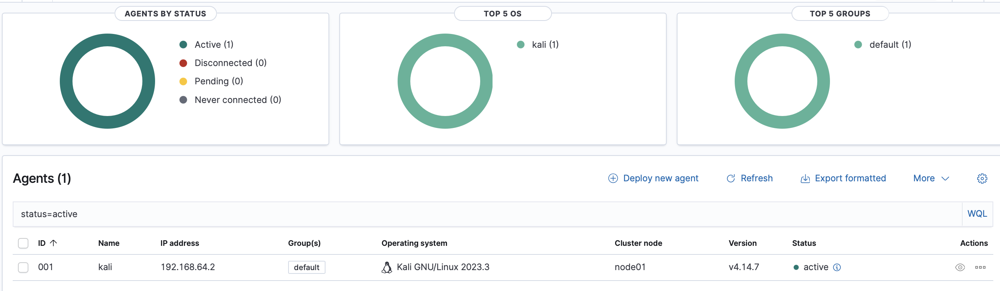
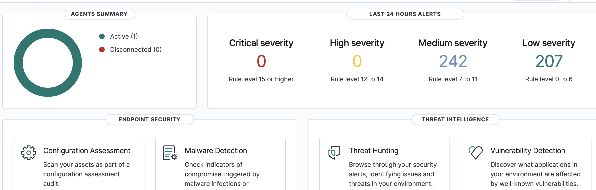

# Wazuh SIEM Home Lab

### Security Monitoring | Threat Detection | Log Analysis | MITRE ATT&CK

## Project Overview

This repository documents the deployment and ongoing development of a Security Information and Event Management (SIEM) home lab using Wazuh, Ubuntu Server, Kali Linux, and UTM virtualization on an Apple Silicon MacBook Air.

The project was created to develop hands-on Security Operations Center (SOC) analyst skills through centralized security monitoring, endpoint log collection, threat detection, and security event investigation.

After deploying the Wazuh environment and connecting a Kali Linux endpoint, I generated controlled SSH authentication failures and investigated the resulting security alerts using Wazuh Threat Hunting.

The project will continue expanding as additional monitoring scenarios and investigations are completed.

---

## Lab Architecture

| Component | Technology | Purpose |
|---|---|---|
| Host Machine | Apple Silicon MacBook Air | Physical host |
| Virtualization | UTM | Runs the virtual machines |
| SIEM Server | Ubuntu Server 22.04 LTS (ARM64) | Hosts Wazuh components |
| Monitored Endpoint | Kali Linux (ARM64) | Generates security events |
| SIEM Platform | Wazuh | Centralized security monitoring |
| Endpoint Agent | Wazuh Agent | Collects endpoint telemetry |
| Authentication Service | OpenSSH | Provides authentication events |

### Architecture Diagram

```text
                Apple Silicon MacBook Air
                           |
                    UTM Virtualization
                           |
             +-------------+-------------+
             |                           |
             v                           v
      Ubuntu Server 22.04             Kali Linux
      -------------------             ----------
      Wazuh Manager                   Wazuh Agent
      Wazuh Indexer                   OpenSSH
      Wazuh Dashboard                 Auth Logs
             ^                           |
             |                           |
             +------ Security Events ----+
```

The Kali Linux endpoint communicates with the Wazuh manager, allowing authentication events to be collected and analyzed through the dashboard.

---

## Completed Project Milestones

### 1. Wazuh Deployment and Configuration

- Deployed an Ubuntu Server virtual machine using UTM.
- Installed and configured Wazuh components.
- Established access to the Wazuh web dashboard.
- Configured a Kali Linux endpoint with the Wazuh agent.
- Verified successful agent enrollment and connectivity.
- Troubleshot ARM64 compatibility, HTTPS certificate access, and virtual machine networking.

**Documentation:** [Wazuh Installation and Configuration](docs/01-wazuh-installation.md)

### 2. SSH Authentication Failure Investigation

Conducted a controlled security monitoring investigation to evaluate Wazuh's ability to detect repeated failed SSH authentication attempts.

**Investigation activities:**

- Generated failed SSH authentication events on the Kali Linux endpoint.
- Reviewed the resulting alerts through Wazuh Threat Hunting.
- Examined alert metadata, including source address, username, and affected endpoint.
- Identified Wazuh detection rule 5712 with severity level 10.
- Analyzed the MITRE ATT&CK mapping to T1110 (Brute Force) under the Credential Access tactic.
- Documented findings and supporting evidence.

The test originated from the local loopback address (`::1`) within the controlled lab environment. The investigation demonstrated detection and analysis of authentication failures, not a successful account compromise.

**Documentation:** [SSH Authentication Failure Investigation](docs/02-ssh-bruteforce-investigation.md)

---

## Lab Screenshots

### Wazuh Dashboard


*Wazuh dashboard providing centralized visibility into the monitoring environment.*

### Kali Linux Agent



*Kali Linux endpoint successfully enrolled and monitored through Wazuh.*

### SSH Authentication Detection



*Wazuh security alert generated during the controlled SSH authentication investigation.*

---

## Technical Skills Demonstrated

| Category | Skills and Technologies |
|---|---|
| SIEM & Monitoring | Wazuh, centralized log collection, endpoint monitoring |
| Security Operations | Alert investigation, log analysis, threat detection |
| Threat Analysis | MITRE ATT&CK, T1110, authentication event analysis |
| Operating Systems | Ubuntu Server, Kali Linux, Linux administration |
| Infrastructure | UTM virtualization, ARM64, virtual machine networking |
| Documentation | Technical reporting, investigation documentation, GitHub |

---

## Challenges and Lessons Learned

### ARM64 Compatibility

Deploying the environment on Apple Silicon required attention to processor architecture and compatible Linux installations.

### Virtual Machine Configuration

Resolved installation and boot issues, including removing the installation ISO after Ubuntu was installed.

### Dashboard Connectivity

Troubleshot Wazuh service availability, HTTPS access, and browser certificate warnings within the local lab.

### Endpoint Monitoring

Configured the Wazuh agent and verified communication between the monitored Kali Linux endpoint and the SIEM server.

### Security Investigation

Practiced interpreting detection rules, reviewing authentication-related security events, and mapping observed activity to MITRE ATT&CK.

---

## Future Investigations

The following activities are planned and have not yet been completed:

- [ ] File integrity monitoring
- [ ] Linux account creation and modification monitoring
- [ ] Privilege-related event detection
- [ ] Vulnerability monitoring
- [ ] Windows endpoint monitoring
- [ ] Sysmon integration
- [ ] Custom Wazuh detection rules
- [ ] Additional SOC-style investigation reports

---

## Project Documentation

| Document | Description |
|---|---|
| [Wazuh Installation](docs/01-wazuh-installation.md) | Deployment, architecture, configuration, and troubleshooting |
| [SSH Authentication Investigation](docs/02-ssh-bruteforce-investigation.md) | Detection methodology, alert analysis, MITRE ATT&CK mapping, and evidence |

---

## Project Status

**Ongoing development**

The initial deployment and SSH authentication investigation have been completed and documented.

Additional investigations, monitoring capabilities, and documentation will be added as the home lab continues to develop.
