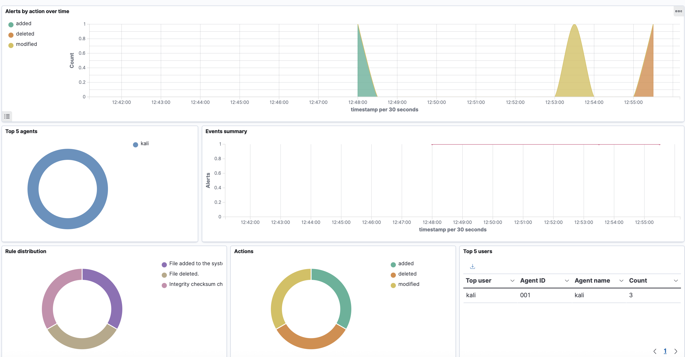
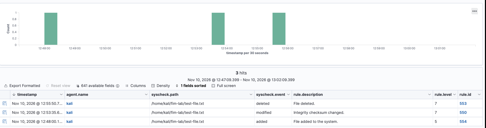

# Investigation 02: File Integrity Monitoring (FIM)

## Objective

Configure Wazuh File Integrity Monitoring (FIM) to detect file creation, modification, and deletion on a monitored Kali Linux endpoint.

This investigation demonstrates how a SOC analyst can use endpoint telemetry to identify unexpected file changes and investigate security alerts.

## Lab Environment

- SIEM: Wazuh
- Wazuh Server: Ubuntu Server 22.04 LTS
- Monitored Endpoint: Kali Linux
- Virtualization: UTM on Apple Silicon macOS
- Monitoring Mode: Real-time FIM
- Monitored Directory: `/home/kali/fim-lab`

## FIM Configuration

Created a dedicated test directory on the Kali endpoint:

```bash
mkdir -p ~/fim-lab
```

Modified the Wazuh agent configuration at `/var/ossec/etc/ossec.conf` by adding the following entry inside the `<syscheck>` section:

```xml
<directories realtime="yes" check_all="yes">/home/kali/fim-lab</directories>
```

Restarted the Wazuh agent to apply the configuration:

```bash
sudo systemctl restart wazuh-agent
```

Verified that the agent was running and connected to the Wazuh manager.

## Testing Methodology

### Test 1: File Creation

Created a new text file inside the monitored directory:

```bash
echo "FIM test: original file" > ~/fim-lab/test-file.txt
```

**Result:** Wazuh detected the newly created file.

- Rule ID: 554
- Alert Level: 5
- Event: Added

### Test 2: File Modification

Appended additional content to the existing file:

```bash
echo "FIM test: file has been modified" >> ~/fim-lab/test-file.txt
```

**Result:** Wazuh detected the file modification.

- Rule ID: 550
- Alert Level: 7
- Event: Modified

### Test 3: File Deletion

Deleted the test file:

```bash
rm ~/fim-lab/test-file.txt
```

**Result:** Wazuh detected the file deletion.

- Rule ID: 553
- Alert Level: 7
- Event: Deleted

## Detection Results

| Test | Event | Rule ID | Alert Level | Result |
|------|-------|---------|-------------|--------|
| 1 | File Created | 554 | 5 | Detected |
| 2 | File Modified | 550 | 7 | Detected |
| 3 | File Deleted | 553 | 7 | Detected |

All three file operations generated corresponding alerts in the Wazuh File Integrity Monitoring dashboard.

## MITRE ATT&CK Mapping

The Wazuh Threat Hunting dashboard displayed mappings associated with:

- T1485 - Data Destruction
- T1070.004 - File Deletion
- T1565.001 - Stored Data Manipulation

These mappings provide context for how file changes may relate to adversary behavior.

The tests in this investigation involved harmless file operations, not actual malicious activity. FIM alerts alone do not establish malicious intent.

## Evidence

### FIM Dashboard Overview



The dashboard displayed three alerts corresponding to file creation, modification, and deletion.

### Individual FIM Alerts



The event records showed the monitored file path, Wazuh rule IDs, alert levels, and detected actions.

## SOC Analyst Takeaways

- Configured real-time file integrity monitoring on a Linux endpoint.
- Generated and investigated file creation, modification, and deletion alerts.
- Identified Wazuh rule IDs and alert severity levels.
- Reviewed MITRE ATT&CK mappings associated with file changes.
- Demonstrated how FIM can support endpoint monitoring and incident investigation.

## Conclusion

Successfully configured and validated Wazuh File Integrity Monitoring in a virtualized cybersecurity lab.

The Wazuh agent detected all three test file operations and forwarded the resulting alerts to the SIEM dashboard.

This investigation demonstrates the value of monitoring file changes and reviewing endpoint telemetry to identify potentially suspicious activity.
